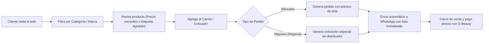

# Documento de Contexto del Proyecto: D-BEAUTY

---

## 1. Identidad y Visión General del Proyecto

* **Nombre Comercial:** D-BEAUTY
* **Lema / Subtítulo:** *Lashes, brows & more*
* **Sector:** Comercializadora y Distribuidora de Insumos y Mobiliario de Belleza Profesional.
* **Propósito y Misión:** Ser la distribuidora de confianza número uno para dueñas de negocios de belleza (salones, estéticas, spas, lashistas y cosmetólogas), ofreciendo un catálogo integral y accesible, complementado con entregas rápidas y atención directa.
* **Activos de Marca:**
  * **Logotipo oficial:** Guardado en [assets/logo.jpg](file:///C:/Users/crist/Documents/Mau01/assets/logo.jpg).
  * **Estilo visual:** Tipografía serif elegante, isotipo de pestañas y acentos dorados (*Lashes, brows & more*).
  * **Paleta cromática:** Tonos rosa (blush pink, rosa pastel), combinados con blanco puro, negro elegante y detalles en dorado metálico.

---

## 2. Propuesta de Valor y Diferenciadores

1. **"Todo en un solo lugar":** Surtido completo de consumibles, herramientas y mobiliario para que las dueñas de negocio no tengan que comprar a múltiples proveedores.
2. **Entregas Prontas (Velocidad y Fiabilidad):** Prioridad absoluta en la rapidez de entrega tanto a nivel local (reparto ágil para urgencias de cabina) como envíos exprés nacionales.
3. **Atención y Cotización Personalizada por WhatsApp:** Trato directo de persona a persona, permitiendo negociar precios de mayoreo, resolver dudas técnicas de productos y coordinar pagos y envíos en un solo canal.
4. **Transparencia:** Catálogo abierto con precios de menudeo visibles y cotizaciones claras para volumen/mayoreo.

---

## 3. Público Objetivo y Roles de Usuario

* **Cliente B2B (Principal):**
  * Dueñas de salones de belleza, estéticas, estudios de pestañas (*lashes*), micropigmentadoras (*brows*), técnicas en uñas y cosmetólogas.
  * *Necesidad:* Un proveedor confiable, precios competitivos por volumen, stock garantizado y envíos rápidos.
* **Cliente B2C (Secundario):**
  * Público en general y consumidoras finales que desean comprar productos de belleza de grado profesional a precio de menudeo.
* **Administrador / Dueño de D-BEAUTY:**
  * Gestiona el catálogo, inventario, precios y estados de stock **exclusivamente a través de archivos Markdown (`.md`)**, sin requerir conocimientos de programación ni escribir código.

---

## 4. Líneas de Productos y Categorías Principales

El catálogo se organizará en 6 grandes categorías especializadas:

1. **Lashing (Pestañas):** Blisters de pestañas (tecnológicas, mink, volumen ruso), adhesivos profesionales, primers, bonder, removedores, pinzas de precisión, parches de hidrogel y cepillos desechables.
2. **Brows (Cejas):** Tintes especiales, henna orgánica, kits de laminado de cejas, perfiladores, calibradores/reglas de visagismo y pastas de diseño.
3. **Uñas:** Acrílicos, monómeros de bajo olor, gel semipermanente, bases y top coats, lámparas UV/LED, pinceles kolinsky, drill y fresas, sanitizantes y decoración.
4. **Cabello:** Tratamientos de reestructuración, botox capilar, keratina, tintes, decolorantes, protectores térmicos, planchas, secadoras profesionales y tijeras.
5. **Mobiliario:** Camillas ergonómicas para lashistas/spa, lámparas media luna (*Half Moon*), aros de luz, carritos auxiliares de servicio y bancos hidráulicos.
6. **Skincare:** Limpiadores faciales, tónicos equilibrantes, sueros hidratantes, mascarillas hidroplásticas, bloqueadores solares y aparatología básica (alta frecuencia, espátula ultrasónica).

---

## 5. Arquitectura y Enfoque Técnico ("Markdown-First")

* **Filosofía del Sistema:** Web estática moderna (*Static Site Generator / Jamstack*) orientada a contenido en archivos Markdown.
* **Cero Código para el Usuario:** Toda la administración de productos, categorías, inventarios y configuración de contacto se realiza creando o modificando archivos `.md`.
* **Fuente de Verdad de Datos:**
  * No se utilizan bases de datos tradicionales (MySQL, PostgreSQL o MongoDB).
  * Los archivos `.md` con metadatos (*frontmatter*) almacenan la información de cada producto (nombre, descripción, categoría, marca, precio menudeo, estatus de stock y enlace de imagen).
* **Gestión de Multimedia (Imágenes):**
  * Para mantener el repositorio ágil y liviano, las imágenes de los productos se enlazan mediante **URLs externas** (Cloudinary, Google Drive público, Imgur o CDNs).
* **Control de Inventario y Stock:**
  * Cada producto cuenta con un campo de estatus: `disponible` o `agotado`.
  * **Regla de Agotados:** Si un producto está marcado como agotado, **permanece visible en el catálogo con un distintivo visual claro de "Agotado"**, deshabilitando la compra directa al menudeo pero permitiendo solicitar información o pedido bajo demanda vía WhatsApp.
* **Control de Versiones con Git:**
  * Cada actualización de catálogo, cambio de precio o ajuste de inventario se registra mediante commits en Git, garantizando historial completo y respaldo.
* **Hosting y Despliegue Recomendado:**
  * Despliegue continuo en plataformas automáticas como **Vercel**, **Netlify** o **GitHub Pages**, las cuales compilan el sitio web cada vez que se sube un cambio en los archivos Markdown.

---

## 6. Flujo de Compra y Cotizador WhatsApp



### Formato del Mensaje Preformateado de WhatsApp
Al presionar el botón de checkout o cotización, el sistema genera automáticamente un enlace de WhatsApp (`https://wa.me/...`) con un mensaje similar al siguiente:

```text
🌸 ¡Hola D-BEAUTY! Me interesa ordenar/cotizar los siguientes productos:
--------------------------------------------------
• 2x Blister Pestañas Nagaraku Mixto (Ref: LASH-012) - $180 c/u
• 1x Adhesivo Sky Glue Tapa Roja 5ml (Ref: LASH-003) - $290 c/u
• 1x Camilla Plegable Spa Rosa (Ref: MOB-001) - $2,800 c/u
--------------------------------------------------
💰 Total estimado (menudeo): $3,450 MXN
🏷️ Tipo de cliente: [ ] Menudeo  [x] Dueña de Negocio (Mayoreo)
📦 Envío para: [Ciudad y Código Postal]
--------------------------------------------------
¿Me podrían confirmar disponibilidad y cotización de mayoreo/envío rápido? ¡Gracias!
```

---

## 7. Alcance del Proyecto: In-Scope vs. Out-of-Scope

### ✅ Dentro del Alcance (In-Scope)
* Catálogo web visual responsivo (óptimo para smartphones y computadoras de escritorio).
* Generación dinámica de la tienda a partir de archivos Markdown (`.md`).
* Filtros interactivos por categorías (Lashing, Brows, Uñas, Cabello, Mobiliario, Skincare) y por marcas.
* Sistema de Carrito / Cotizador interactivo en el navegador (guarda la selección temporal del cliente).
* Botón de cierre hacia WhatsApp con mensaje estructurado de cotización.
* Etiquetado de productos "Agotados" con opción de consulta bajo pedido.
* Repositorio Git estructurado y configurado.

### ❌ Fuera del Alcance (Out-of-Scope)
* **Pasarelas de pago bancario en línea:** No se integrará Stripe, PayPal ni cobros con tarjeta en la web (los pagos se acuerdan por WhatsApp mediante transferencia, depósito o pago contra-entrega).
* **Cuentas de usuario y contraseñas:** No habrá inicio de sesión, registro ni perfiles de usuario.
* **Bases de datos SQL/NoSQL:** No habrá servidores de bases de datos externas; todo reside en Git y Markdown.
* **Panel de administración complejo:** No habrá backend pesado; la administración se hace con tu editor de texto favorito sobre los archivos `.md`.

---

## 8. Estructura de Directorios del Repositorio

```text
Mau01/
├── .git/                      # Control de versiones Git
├── assets/
│   └── logo.jpg              # Logotipo oficial de D-Beauty
├── content/
│   ├── configuracion/
│   │   └── general.md        # Datos de contacto, número de WhatsApp, banners, textos
│   └── productos/            # Fichas de productos en formato Markdown
│       ├── lashing/
│       ├── brows/
│       ├── unas/
│       ├── cabello/
│       ├── mobiliario/
│       └── skincare/
├── CONTEXT.md                 # Este documento de contexto integral
└── README.md                  # Guía rápida de uso y mantenimiento para el usuario
```

---

## 9. Plantilla Estándar para Fichas de Producto (.md)

Cada producto del catálogo se representará mediante un archivo Markdown sencillo como el siguiente:

```markdown
---
id: "LASH-001"
nombre: "Adhesivo Sky Zone 5ml"
categoria: "lashing"
marca: "Sky"
precio_menudeo: 320
precio_mayoreo_sugerido: 260
piezas_minimo_mayoreo: 3
estatus: "disponible" # opciones: disponible | agotado
imagen_url: "https://ejemplo.com/imagenes/adhesivo-sky.jpg"
destacado: true
---

### Descripción del Producto
Adhesivo profesional para extensiones de pestañas. Tiempo de secado rápido (1 a 2 segundos) y retención prolongada de hasta 6 semanas.

### Especificaciones
* **Contenido:** 5 ml
* **Secado:** 1-2 segundos
* **Humedad recomendada:** 45% - 65%
* **Temperatura:** 18°C - 24°C
```

---

## 10. Hoja de Ruta (Roadmap)

1. **Fase 1 (Completada):** Entrevista de requerimientos, validación de alcances, inicialización de Git y redacción del documento `CONTEXT.md`.
2. **Fase 2:** Creación de la estructura de carpetas `content/` y carga de plantillas y productos de ejemplo en Markdown para cada una de las 6 categorías.
3. **Fase 3:** Configuración de la plantilla web estática (código HTML/JS/CSS ligero o generador estático que lea los `.md`) con diseño en tonos rosa/dorado y responsive design.
4. **Fase 4:** Prueba del carrito y del generador de enlaces de WhatsApp.
5. **Fase 5:** Despliegue en producción (Vercel / Netlify / GitHub Pages) listo para compartir con clientas.
